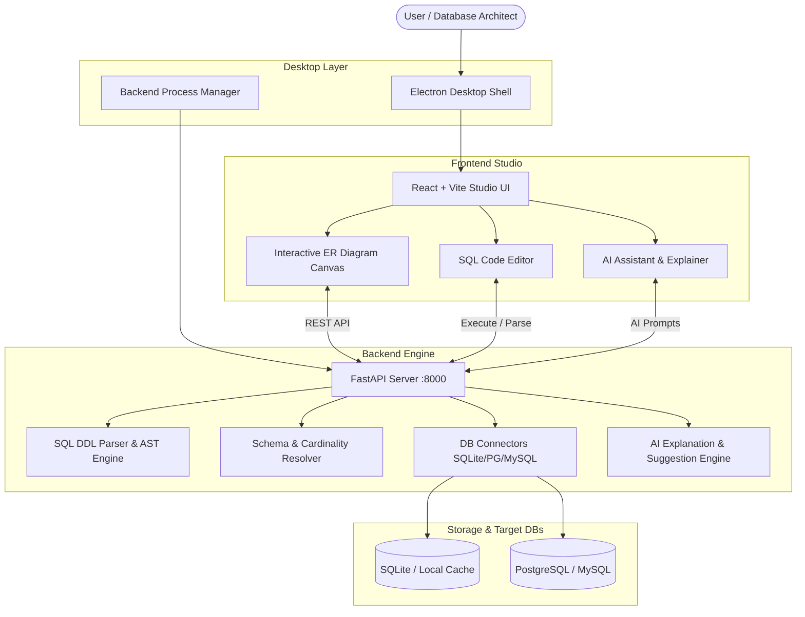

# SQL2ER STUDIO - System Architecture

## 1. High-Level Architecture Overview

SQL2ER STUDIO is organized into a modular 3-tier architecture:
1. **Desktop Presentation & Shell (Electron)**
   - Wraps the frontend web client in an isolated desktop window.
   - Manages the child FastAPI server process lifecycle via `backend_manager.js`.
   - Native OS file dialogs for loading and saving `.sql`, `.db`, and image files.
2. **Frontend Studio (React 18 + Vite + React Flow)**
   - Interactive Canvas: Node-based visual representation of relational tables.
   - SQL Editor: Syntax highlighting, query execution tabs, and execution metrics.
   - State Store: Centralized state management using lightweight store patterns.
   - Real-time AI Assistant: Context-aware recommendations and relationship explanation panels.
3. **Backend Service & Processing Engine (FastAPI + Python)**
   - Parser Pipeline: Multi-dialect SQL DDL parsing and AST extraction.
   - Schema Engine: Relationship synthesis, cardinality resolution ($1:1$, $1:N$, $N:M$), and normalization audits.
   - Database Connectors: Direct introspection for SQLite, PostgreSQL, and MySQL.
   - AI Reasoning: Pluggable engine supporting local heuristic rules, Ollama, OpenAI, and Gemini.

